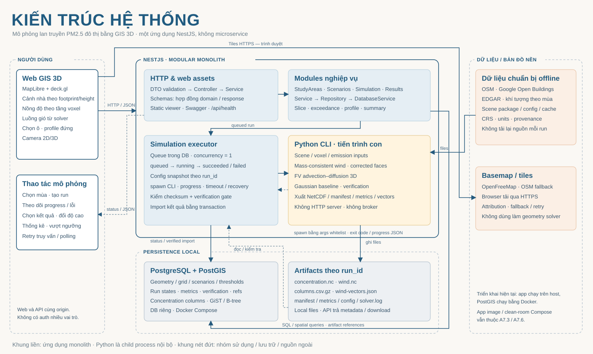

# IE402 — Urban Air Pollution Dispersion with 3D GIS

This project models PM2.5 dispersion around Nguyễn Huệ Walking Street in Ho Chi Minh City. It uses a mass-consistent diagnostic wind field and finite-volume transport on a 3D voxel grid. The standard domain is 500 × 500 × 100 m with 500,000 cells of 5 × 5 × 2 m. The modeled concentrations represent the contribution of the selected emission source under the specified assumptions.

## Team

| Member | Responsibility | Deliverables |
| --- | --- | --- |
| **Tâm** | All four engineering upgrade phases | React migration, English-first localization with Vietnamese support, spatial SQL and CSV, run orchestration, Python gRPC service and worker, deployment, CI and end-to-end verification. |
| **Thanh** | GIS data and scientific verification | Dataset provenance and rights, independent spatial reference calculations, numerical parity review, sensitivity studies and scientific figures. |
| **Both** | Release and course assessment | Review the evidence and align the demo, report and slides with one verified revision. |

See the [upgrade plan](docs/UPGRADE_PLAN.md) and [milestone roadmap](docs/ROADMAP.md).

## Run the current demo

Install Git and Docker with Compose v2. On Windows, start Docker Desktop with Linux containers. The first build downloads dependencies. The repository includes the scientific demo inputs and scene package. External basemap tiles require internet access.

Run from the repository root in PowerShell:

```powershell
$env:SOURCE_REVISION = (git rev-parse --short HEAD).Trim()
docker compose up -d --build --wait
docker compose ps
```

- [WebGIS](http://localhost:3000/)
- [API documentation](http://localhost:3000/api/docs)
- [Health endpoint](http://localhost:3000/api/health)

Startup verifies the input bundle, migrates PostGIS and loads the scene. Set `$env:APP_HOST_PORT = '3001'` before startup if port 3000 is in use. Use `docker compose logs --tail 100 app db` to inspect startup and `docker compose stop` to stop the stack while keeping volumes. Use a separate database for a different input revision once the existing database contains runs.

## Explore the results

| Feature | How to try it |
| --- | --- |
| 3D map | Rotate and zoom to inspect LoD1 buildings and modeled wind. |
| Simulation | Select a dry or wet season and a source preset of 100%, 80% or 60%. Start a run and wait for verification. |
| Slices and profiles | Change height and select a voxel. A center height of 1 m represents the 0–2 m layer. |
| Region and transect | Draw a polygon or line. Inspect volume-weighted region statistics or a vertical cross-section. |
| Comparison and export | Compare compatible runs at the same layer. The difference is comparison minus baseline. Export CSV, PNG or JSON where available. |

Concentrations are in µg/m³. Solid, missing and zero-valued cells have distinct meanings. Gaussian provides a comparison baseline. Use the run ID, configuration, manifest and NetCDF to trace exported results. Reference thresholds help explore model output. Field validation requires suitable measurements.

## Architecture and source



The current demo serves the viewer and REST API from NestJS. NestJS launches Python as a subprocess, verifies its artifacts and imports results into PostgreSQL/PostGIS. The upgrade targets a React UI and a separate Python Solver Service with private gRPC. PostgreSQL owns the queue and GIS state. See [current and target architecture](docs/ARCHITECTURE.md).

```text
app/src/modules/    NestJS scene, simulation, results and health modules
app/src/database/   Migrations, seed, import and benchmarks
web/                Current WebGIS and its tests
web/map/            Grid, wind flow and display LoD modules
src/                GIS preparation, voxelization and numerical solver
tests/              Python numerical and data contract tests
db/                 SQL migrations and scene seed
deploy/             Compose settings, demo inputs and provenance
scripts/            Preflight, benchmarks and cleanroom verification
docs/               Specification, architecture, research and roadmap
```

## Verify and reproduce

```powershell
node --test (Get-ChildItem web/tests/*.test.cjs | Select-Object -ExpandProperty FullName)
node scripts/demo-preflight.mjs --url http://localhost:3000
```

See the [backend guide](app/README.md) for PostGIS tests. The [independent CI workflow](.github/workflows/independent-demo.yml) checks a clean build, two real runs, queries, checksums and restart. Use the [demo profile](deploy/demo-profile.json) for provenance of the pinned handoff.

- [Specification](docs/spec.md) and [database design](docs/DATABASE.md)
- [Research and source reduction study](docs/RESEARCH.md) and [emission assumptions](docs/emission_assumptions.md)
- [Data rights and third-party notices](docs/LICENSING.md)

The legacy research exporter can regenerate its static files with `python src/06_export_web.py --config config/project.yaml` once the required GIS and NetCDF inputs are available.
