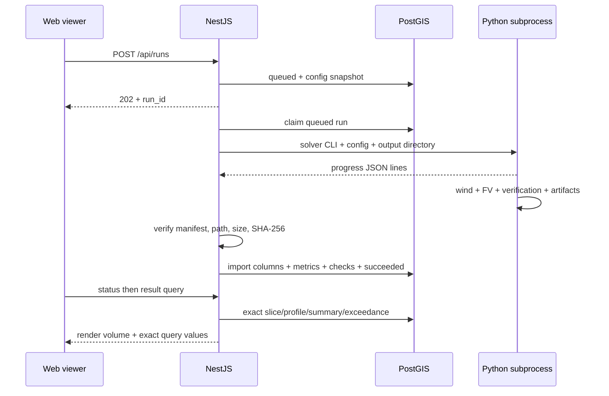

# Báo cáo candidate tuần 7

Bản nháp này mô tả sản phẩm đang chạy và quy định nguồn số liệu dùng trong
báo cáo cuối. Bảng nghiệm thu được sinh từ artifact, không lấy con số mặc
định trong phần mô tả làm kết quả thực nghiệm.

## 1. Bài toán và phạm vi

Đề tài mô phỏng lan truyền PM2.5 trong một miền đô thị ba chiều bằng lưới
voxel. Study area Nguyễn Huệ có miền 500 × 500 × 100 m, 100 × 100 × 50 ô;
kích thước ô 5 × 5 × 2 m. Hệ thống trình bày phân bố nồng độ theo độ cao,
truy vấn một cột đứng và so sánh hai kịch bản khí tượng.

Kết quả chính là diagnostic mass-consistent wind và finite-volume
advection–diffusion. Gaussian là baseline đối chiếu. Phạm vi không có CFD
RANS/LES, hóa học khí quyển, exposure dân số hoặc dự báo quan trắc 24 giờ.
Không gọi phương pháp hiện tại là Röckle đầy đủ.

## 2. Dữ liệu và độ tin cậy hình học

| Lớp | Hiện có | Nguồn/provenance |
|---|---:|---|
| Building footprints | 62 | OSM; source feature IDs trong scene package |
| Building heights | 62 | Google Open Buildings 2.5D; height source per feature |
| Roads | 67 segments | OSM; highway class và emission weight |
| Water | 1 feature | OSM; sông Sài Gòn ngoài miền mô phỏng |
| Green cover | 17 features | OSM park/garden/grass/scrub |
| Grid columns | 10.000 | Cùng origin, CRS và spacing với solver |

Tất cả geometry mô hình dùng EPSG:32648. API chuyển geometry sang WGS84
cho web, không sửa geometry khoa học. Footprints và height được dựng LoD1,
mái phẳng, terrain z=0. Cửa sổ/vật liệu mặt đứng là minh họa.

Scene manifest lưu provenance, counts, grid và checksum từng CSV. Seed
từ chối dữ liệu sai checksum. Audit độc lập đối chiếu scene columns với
voxel mask và raster hóa footprints/heights; report mới nằm trong
`geometry_audit` của analysis JSON.

Nguồn OSM có thể thiếu nhà thấp. Height GOB không phải khảo sát tại chỗ.
Sensitivity height ±20% raster hóa lại mask để đánh giá ảnh hưởng, không
chỉ thay chiều cao render. Hai sensitivity scene không được nạp vào DB
baseline có geometry khác.

Phát thải dùng EDGAR v8.1, năm 2022, sector TRO. Flux khu vực được phân bổ
theo road-length/class proxy. Đây không phải vehicle counts hoặc emission
inventory khảo sát riêng từng đường. Bundle demo giữ source đã chuẩn hóa
cùng attribution/normalization metadata để chạy offline sau image build.

## 3. Phương pháp số

Gió diagnostic được điều chỉnh để giảm divergence, với building mask làm
biên rắn. Solver lưu corrected face velocities; transport dùng chính các
face flux đã được verification. Vector web được downsample từ kết quả này
theo tầng/run, không thay thế bằng metadata gió nền.

Transport giải tải–khuếch tán thể tích hữu hạn trên lưới voxel. Implementation
sparse preassembles cùng toán tử explicit FV; upwind dùng Courant target
0,5. K ngang 2 m²/s và K đứng 1 m²/s là tham số mô hình, không phải đo đạc
turbulence tại hiện trường.

Steady-state dùng relative L1 change của trường nồng độ qua khoảng 30 s.
Chỉ bắt đầu xét đủ điều kiện sau 600 s mô phỏng; cần 3 check liên tiếp
≤ 0,001. Giới hạn 1.800 s chưa hội tụ phải fail. Wall-clock và simulated
time được lưu riêng; không sử dụng chúng thay thế nhau trong bảng runtime.

Mass ledger theo dõi emitted, remaining và escaped. Positivity được kiểm
trước các correction; không clip số âm để che lỗi. Candidate production
yêu cầu mass correction bằng 0 và các verification gate đều pass.

Modified-equation numerical diffusion estimate được đặt cạnh physical K.
Nó là xấp xỉ local 1D và không có đủ mixed terms 3D. Có kết quả ổn định
không đồng nghĩa đã grid-converged.

## 4. Verification và sensitivity

| Check | Bằng chứng | Diễn giải |
|---|---|---|
| Advection | Python verification tests | Blob đi theo vận tốc/thời gian |
| Diffusion | Nghiệm heat equation | Variance tăng 2Kt |
| CFL | Per-run gate | Time step trong giới hạn chốt |
| Divergence | Corrected face flux gate | Cùng flux transport sử dụng |
| Positivity | Per-run gate | Không có nồng độ âm vượt tolerance |
| Wall flux | Per-run gate | Không xuyên building solids |
| Mass balance | Ledger + relative error | Emitted ≈ remaining + escaped |
| Steady state | History và residual | Không lấy transient làm steady result |
| Geometry | Scene/voxel audit | Không đảo trục, lệch CRS/footprint |

Final candidate chạy năm case: mùa khô, mùa mưa, K×0,5, height×0,8 và
height×1,2. Tất cả dùng cùng model version. Bảng sensitivity ghi thay đổi
mean/max so với baseline khô; figures/tables truy được về run IDs và hashes.

Cross-check độc lập heat equation dùng K=1 m²/s, t=20 s nên variance giải
tích là 40 m². Verification dùng tolerance 1%. Gaussian là comparison model;
MAE/RMSE FV–Gaussian đo sự khác biệt hai giả định mô hình, không phải sai số
so với quan trắc.

## 5. Kiến trúc sản phẩm

Ứng dụng là NestJS modular monolith. Nó phục vụ web/API, truy vấn PostGIS,
quản lý trạng thái và gọi Python subprocess nội bộ. Không tách solver thành
HTTP service và không cần message broker cho concurrency=1.

Snapshot cấu hình nằm trong run ngay lúc tạo. Retry dùng snapshot cũ,
attempt tăng nhưng không nhân đôi result rows. Restart recovery chuyển run
đang chạy thành stale; completed runs và artifacts vẫn truy vấn được.
Manifest hoặc verification sai thì run không được đánh dấu succeeded.

## 6. Cơ sở dữ liệu và query

Schema gồm study areas, scene features, grid cells, scenarios, thresholds,
simulation runs, concentration columns, metrics, checks và artifacts.
ERD/data dictionary nằm trong `DATABASE.md`; SQL migrations là source
of truth của schema. GiST hỗ trợ geometry, B-tree/PK hỗ trợ run/grid indices.

NetCDF giữ tensors đầy đủ; PostGIS giữ geometry và concentration column
arrays phục vụ queries. UI render dùng uint8 volume để giảm payload, nhưng
profile/summary/cell statistics đọc giá trị chính xác từ API/DB.

| Query | Hành vi cần chứng minh |
|---|---|
| Slice | Chọn ô chứa z request; bbox optional; bỏ solid cells |
| Exceedance | Threshold có units/key; diện tích tầng và thể tích rõ |
| Profile | Một grid column, 50 tầng, null trong solids |
| Summary | Aggregates theo tầng; metrics và verification của cùng run |

Benchmark candidate có warm-up và 20 samples/query, p50/p95, storage và
EXPLAIN (ANALYZE, BUFFERS). Exceedance/summary có thể aggregate volume đã
lọc run; không yêu cầu mọi query đều index-only. Runtime không phải SLA.

## 7. Web GIS 3D và đóng góp 3D

MapLibre/deck.gl dựng LoD1 scene, lớp đường/nước/xanh và concentration
slice. Người dùng đổi run, kéo cao độ, chọn ô hoặc nhập i/j, xem profile,
threshold và statistics. Gió chuyển động lấy vector solver theo run/tầng,
không xuyên solid và hỗ trợ pause/reduced motion.

Dashboard evidence hiển thị identity, model version, input hash, ledger,
checks và source warnings. Số liệu khoa học không đổi khi người dùng thay
hệ số minh họa/nền. Stale result responses không thay thế run đang xem.

Đóng góp 3D được trình bày bằng chênh lệch mean/max ở tầng gần mặt đất và
15 m, profile đứng, vertical mass share và exceedance volume. Nồng độ ở
1,5 m request dùng tâm voxel 1 m; báo cáo phải ghi cả requested height và
actual centre height để tránh ngụ ý có lát chính xác 1,5 m.

## 8. Tái lập và kiểm thử hệ thống

Compose gồm app/Python runtime và PostGIS. App image có dependency lock,
demo inputs, config, migrations/seed và static web. Entry point verify
bundle, migrate và seed trước khi khởi động API. Artifact/DB dùng named
volumes; app chạy user không phải root và có healthcheck.

Clean-room script dùng project name mới, volume mới, không mount input
host. Nó tạo hai production runs qua HTTP, kiểm exact queries/checksums,
benchmark, restart và headless browser. Browser screenshots gồm overview,
dashboard, selected cell và mobile viewport; không dùng screenshot làm
chứng minh FPS hoặc tính đúng mô hình.

Regression script giữ mọi suite status, JUnit/JSON và logs. Required E2E
không cho thiếu DB/skip thành pass. Unit symlink Windows có thể skip vì
quyền OS; science suite phải báo count và lý do skip riêng.

## 9. Nguồn số liệu cho bản cuối

| Nội dung | Source artifact |
|---|---|
| Runtime/RSS/residual | `artifacts/week7/production/study.json` |
| Layers/FV–Gaussian/sensitivity | `artifacts/week7/production/analysis.json` |
| Tables/captions/checksums | `artifacts/week7/production/report-assets.json` |
| API/browser/fresh-volume evidence | `artifacts/week7/cleanroom/rehearsal.json` |
| Query latency/plans | `artifacts/week7/cleanroom/query-benchmark.json` |
| Regression counts | `artifacts/week7/checks/checks.json` và Python JUnit |
| Quality matrix | `artifacts/week7/evidence-index.json` |

Snapshot cùng raw NetCDF/log/screenshots chỉ lưu local trong `artifacts/week7/`
và được tái tạo theo runbook. Mỗi claim dùng run ID, metric,
figure/table và limitation, không copy số từ các đợt chạy không rõ version.

## 10. Hạn chế và việc còn lại tuần 8

- EDGAR annual emission proxy và GIS LoD1 có bất định nguồn dữ liệu.
- Terrain phẳng, roof quantisation, diagnostic wind và diffusivity giả định.
- Chưa có validation bằng quan trắc, wind tunnel hoặc spatially resolved CFD.
- Gaussian không là ground truth; chưa chứng minh grid convergence.
- Zero exceedance không chứng minh không khí thực tế an toàn.
- Compose build và browser CDN/basemap cần Internet ở các thời điểm tương ứng.
- Fresh-volume rehearsal chưa thay thế demo trên máy vật lý thứ hai.
- Cần final report, release tag, thuật ngữ review, rehearsal bảo vệ và video dự phòng.

Các giới hạn này giữ nguyên trong bản cuối. Candidate gates pass chỉ có
nghĩa là bằng chứng tuần 7 đạt phạm vi đã chốt; không tự động chốt M7.
