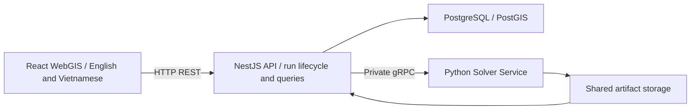

# IE402 upgrade proposal

This proposal maps the Chapter 7 and Chapter 8 lectures to an upgrade of the Nguyễn Huệ PM2.5 project. The current demo uses the web viewer, a NestJS modular monolith, PostGIS and a Python subprocess. React, a separate gRPC solver service and the road corridor analysis are proposed changes.

## What the lectures add

| Course reference | Project decision | Evidence for assessment |
| --- | --- | --- |
| Chapter 7, PDF pp. 5–7 | Document the conceptual, logical and physical models separately. | Show entities and relations first, then keys, voxel indexing and finally SQL types and indexes. |
| Chapter 7, PDF pp. 9–12 | Describe WebGIS presentation, application and data layers. Split the numerical workload into one service. | Explain why solver jobs and interactive queries have different resource needs. Measure deployment and recovery tradeoffs. |
| Chapter 7, PDF pp. 18–22 | Use geometry types and SRIDs deliberately. Demonstrate relationship, measurement and processing operations. | Show the SQL, its plan and the corresponding map result. Document actual format and index support. |
| Chapter 8, PDF pp. 5–11 | Separate a lookup, an analysis and a simulation. Use the six-step workflow to design the study. | Trace one question from inputs and CRS through method, verification and presentation. |
| Chapter 8, PDF pp. 13–19 and 22 | Combine multiple road buffer bands with voxel overlay and altitude ranges. | Verify disjoint bands, partial intersections and air volume. Report the sensitivity to band widths. |

The PDF references use page numbers starting at the cover.

## Data models

| Level | Representation |
| --- | --- |
| Conceptual | A study area contains roads, buildings and a voxel grid. Each simulation run produces a concentration field. A corridor band intersects part of that field at a selected elevation range. |
| Logical | Keep vector footprints and road centerlines, a regular 3D array for the field, and relational links between scene, run and artifacts. Grid neighbors follow the six faces of a cell. Store provenance and the solid mask with a defined scene revision. |
| Physical | Store projected geometry in EPSG:32648, concentration profiles by `(run_id, i, j)` and NetCDF for full fields. Use GiST for spatial candidate selection and B-tree keys for run and grid joins. Convert to WGS84 at the web boundary. |

A regular 3D array fits the FV stencil and altitude profiles. B-Rep is useful for detailed building surfaces but adds geometry work at voxelization. CSG is useful for composing designed solids. The hybrid vector/voxel model keeps urban feature identity and efficient field computation. Display LoD and solver resolution should be measured separately. The [architecture document](ARCHITECTURE.md) has a 2×2×4 example for demonstrating the indexing and partial-volume calculation.

## Priority analysis: road proximity and PM2.5 by altitude

The first implementation exposes `POST /api/runs/:id/road-corridor` and the corresponding `/csv` route. Use road `source_feature_id` values from the run's scene and send increasing outer distances, a height interval and an optional threshold. Repeat the query at different height intervals to compare altitude bands. The response includes band geometry, valid coverage and volume-weighted statistics. The React panel is pending.

Run `npm run db:benchmark:spatial` from `app/` with a verified FV run in the target database. The benchmark uses the endpoint's SQL for one-road and broad corridor requests.

The local benchmark on FV run `2a3ab50e-2202-4b14-9209-3ab1fba4fd92` recorded SQL p50/p95 of 51/81 ms for one road at 1–15 m and 1994/2265 ms for 50 roads at 0–100 m. These are 20 samples per query after three warmups on the 100 × 100 × 50 grid. The report with execution plans is in `artifacts/road-corridor-benchmark.json`.

1. **Question.** Within one modeled run, how do average concentration and volume above a selected reference value vary with distance from selected roads and elevation?
2. **Data.** Use verified run outputs, centerlines and the matching scene. Validate geometries, transform inputs to the projected CRS, and keep missing data distinct from zero and solid cells.
3. **Method.** Begin with illustrative bands 0–10, 10–25 and 25–50 m. Dissolve overlapping buffers from the selected roads and form disjoint bands with differences of cumulative buffers. Clip to the study area. Select candidate cells using their XY footprints, then compute exact XY overlap and intersect the requested altitude interval with each cell's vertical interval.
4. **Execute.** Weight each valid air value by its intersected volume, calculated as XY overlap area times vertical overlap thickness. Report air volume, valid coverage, volume-weighted mean and volume strictly above the chosen value. Bands without valid volume have no mean. Apply the same masks and bands when comparing runs.
5. **Verify.** Use an independent hand-calculated fixture for touching boundaries, partial XY and z overlap, overlapping road buffers, missing values, zero values, solid cells and threshold equality. Compare the aggregate and CSV against a reference. Measure SQL with `EXPLAIN (ANALYZE, BUFFERS)` for narrow and wide requests and report dataset size, candidate counts and repeated latency. A large query may legitimately choose a sequential scan.
6. **Present.** Show a band map, altitude chart and table with units, run ID, band widths and valid coverage. Repeat with alternative widths. Report sensitivity and uncertainty. The modeled difference describes the chosen inputs and scenario.

Use `ST_DWithin` for distance-based filtering, `ST_Buffer` for constructing areas, and `ST_Intersection` and `ST_Area` for overlap weights. The calculation combines planar geometry and vertical interval math. [PostGIS distance queries](https://postgis.net/documentation/tips/st-dwithin/).

## Proposed architecture and delivery order

| Phase | Owner | Acceptance |
| --- | --- | --- |
| 1. PostGIS analysis | Tâm | Existing slice, profile, region and transect pass. Corridor overlay matches hand calculations and has a documented production query plan. |
| 2. React and localization | Tâm | Use React + TypeScript with the existing map rendering stack and REST contract. Mount and clean up map resources through React effects. English is the default, Vietnamese is selectable. Language changes preserve run, layer and map state. Check controls, error messages, legends, number formatting and downloads. Machine-readable fields keep stable names and units. |
| 3. Python gRPC service | Tâm | Expose a versioned proto with short `StartRun` and `GetRunStatus` calls. Keep run ownership in NestJS/PostGIS and identify each execution by run ID and attempt. Test repeated dispatch, worker restart and partial artifacts. Compare old and new execution with the same inputs, fields and tolerances. |
| 4. Engineering acceptance | Tâm | Rehearse from one pinned revision with clean volumes. Include query fixtures, real runs, both UI languages, CSV and a comparison of deployment costs. Use one coherent set of figures and results across the report, slides and demo. |

React should own UI state while MapLibre and deck.gl own their rendering resources. [React effects and external systems](https://react.dev/learn/synchronizing-with-effects).

The browser keeps REST. gRPC is internal to the Compose network. Use explicit deadlines for calls and a separate execution timeout for the solver. Make dispatch idempotent before enabling retries. Keep large NetCDF outputs in artifact storage and return only status and references over gRPC. Verify integrity before importing through NestJS. [gRPC deadlines](https://grpc.io/docs/guides/deadlines/) and [gRPC retries](https://grpc.io/docs/guides/retry/).

### Service ownership and worker

| Component | Owns | Interface |
| --- | --- | --- |
| React WebGIS | Map and analysis UI, language and display state | REST to NestJS |
| NestJS API | Scene catalog, run lifecycle, dispatch, artifact validation/import, spatial queries and exports | REST to browser, private gRPC to solver, SQL to PostGIS |
| Python Solver Service | Admit executions, supervise solver child processes and write attempt artifacts | Private versioned gRPC and shared artifact volume |
| PostgreSQL/PostGIS | Durable queue state, scene and grid, result arrays, spatial indexes and query transactions | SQL through NestJS |

Keep scene and spatial analysis as separate NestJS modules. They share a grid, scene revision and transactional result data. The Python service is the separate compute deployment. Its worker is the OS child process that runs the existing solver CLI for one attempt. Run one solver service replica and **one active child by default**. Enable two only after measuring peak memory, CPU and query latency with two concurrent runs. A worker slot includes a child that is stopping until it has exited and been reaped.

Harness review used Githot Lens as the direct comparison. Its worker handoff documents a separate supervisor, bounded concurrency, stop-before-replace and recovery tests. Its recovery spec also records a source review of Listing Moderation Service. The transferable patterns are durable retry limits, attempt ownership and fault tests. The broker and domain workflows stay specific to those projects.

Use PostgreSQL as the durable queue for IE402. Redis and BullMQ are optional infrastructure for workloads that justify an independent broker. The current claim query combines `SKIP LOCKED` with a check for running jobs. Concurrent dispatchers can lock different queued rows while both observe zero running jobs. To enforce the deployment-wide cap, lock one scheduler row in a short transaction, reserve a free slot, and claim the oldest eligible run before committing. Perform gRPC and simulation outside the transaction. The Python supervisor independently rejects new executions above its process limit. [PostgreSQL SELECT locking](https://www.postgresql.org/docs/current/sql-select.html), [BullMQ global concurrency](https://docs.bullmq.io/guide/queues/global-concurrency).

### Failure and recovery contract

Persist the run ID, attempt, owner token, slot, lease expiry and retry budget in PostgreSQL. `StartRun` is idempotent by run ID and attempt. The worker keeps a durable receipt and terminal status for that key on the shared volume. Use a distinct output directory for each attempt. Publish completion only after the child exits, the manifest is finalized and NestJS verifies checksums. Import rows and update the current attempt to `succeeded` in one transaction. Guard progress, completion and slot release with the current attempt and owner token.

| Failure to reproduce | Expected behavior |
| --- | --- |
| Duplicate HTTP request or concurrent dispatch | Same request ID returns the original run. Multiple dispatchers cannot exceed the configured slot count. |
| gRPC times out after Python accepted the job | Check the durable receipt or resend the same attempt ID. Reuse the existing execution and budget. |
| Python crashes, loses heartbeat or is partitioned | Keep the slot reserved while the outcome is uncertain. Reconcile the receipt and confirm the old child exited or its container stopped before releasing the slot and starting another attempt. |
| Solver hangs or shutdown begins | Stop accepting work, terminate and reap the child with a bounded grace period. Confirm termination before replacement. |
| Partial, corrupt or late result | Reject partial output, checksum mismatch and callbacks from superseded attempts. Preserve diagnostic logs. |
| DB commit succeeds but reply is lost | Re-read the attempt state and return the committed result. A retry cannot insert a duplicate result. |
| Invalid input or scientific gate failure | Record a typed failure. Automatic retry is limited to recoverable infrastructure errors with backoff and a persisted budget. |
| PostGIS is unavailable | Leave accepted state durable and avoid dispatching unrecorded work. Reconcile when DB and worker status are available. |

Test both concurrency settings with real PostGIS, the gRPC service and controlled child processes. Kill the worker before launch, during computation and after artifact creation. Drop a reply after acceptance and after result commit. Include two real FV runs to verify numerical parity, units, masks and provenance.

### PostGIS query contract

| Operation | Implementation to demonstrate | Acceptance |
| --- | --- | --- |
| Viewport slice and point profile | Project the request to EPSG:32648. Use indexed footprint candidates for a slice and deterministic grid indexing for a profile. Read array index `k + 1`. | Correct shared edges, upper boundary and out-of-domain behavior. Compare both results with the same NetCDF run. |
| Road proximity and overlay | Generate dissolved distance bands, clip to the domain, select grid candidates with `ST_Intersects` and compute exact XY overlap. Combine it with vertical interval overlap. | Disjoint bands and correct partial-volume weights, coverage and threshold equality. |
| Region and transect | Use overlap-weighted region stats. Sample transects at measured distances in the projected CRS with an explicit boundary rule. | Hand-check region volume and sample coordinates. Match CSV and API results for solid, missing and zero values. |
| Run comparison | Match scene, grid and mask before comparing by `(i,j,k)`. Use common bands and valid cells for corridor comparisons. | Reject incompatible inputs. Verify self-difference equals zero and export a signed difference with run metadata. |

Document input/output SRIDs, units, indexes and null semantics for each operation. Record `EXPLAIN (ANALYZE, BUFFERS)` and repeated timings against the exact production SQL at representative scales. Chapter 7 evidence is the three-level model, deployment diagram, ERD, SQL and plans. Chapter 8 evidence is one complete buffer/overlay study with a stated question, reproducible inputs, checks, sensitivity and presentation.

## Tóm tắt tiếng Việt

Ưu tiên bổ sung phân tích **khoảng cách đến đường × độ cao** và kiểm số liệu trên PostGIS. Đây là bài toán dùng trực tiếp buffer, overlay và quy trình kiểm chứng của Chương 8. Chương 7 được thể hiện bằng mô hình ba mức, ERD, SRID, chỉ mục và sơ đồ triển khai.

Sau khi có bằng chứng truy vấn, chuyển giao diện sang React với tiếng Anh mặc định và tùy chọn tiếng Việt. Tách Python thành một dịch vụ gRPC nội bộ khi đã chốt kiểm tra tương đương với solver hiện tại. Báo cáo mức 9–10 cần lập luận, số liệu, minh họa và kiểm chứng nhất quán. Xem [đối chiếu rubric](ROADMAP.md#đối-chiếu-rubric-ie402--cập-nhật-01112026) để chốt bản nộp.
